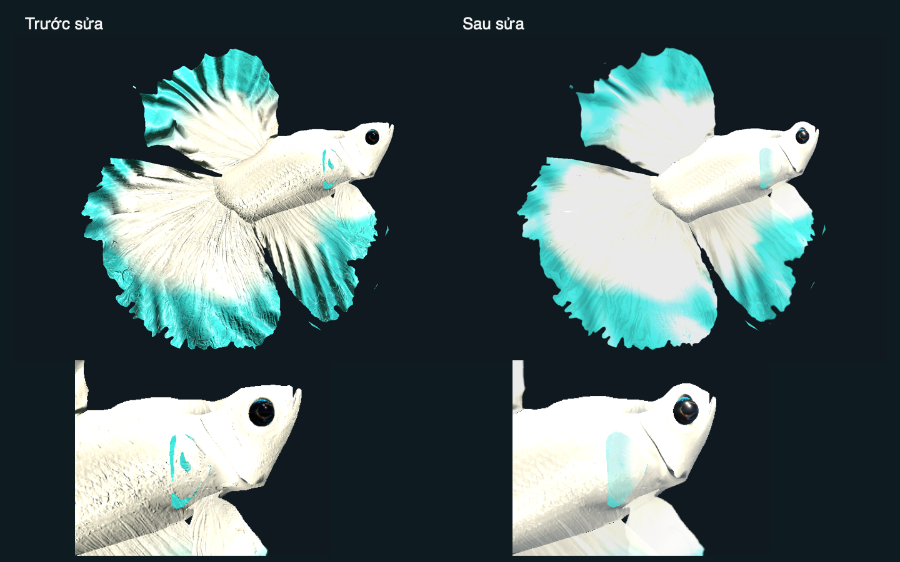
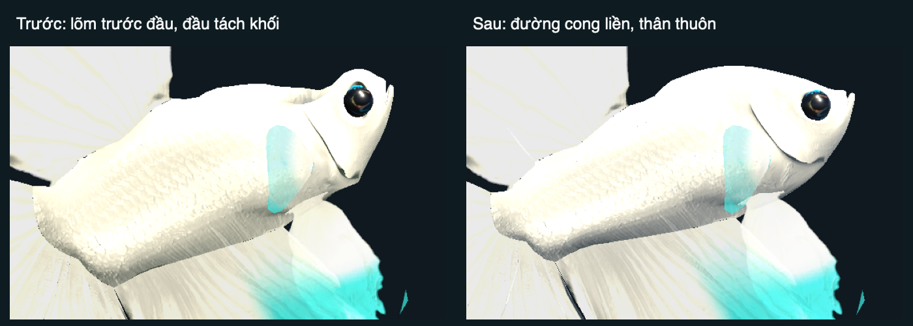
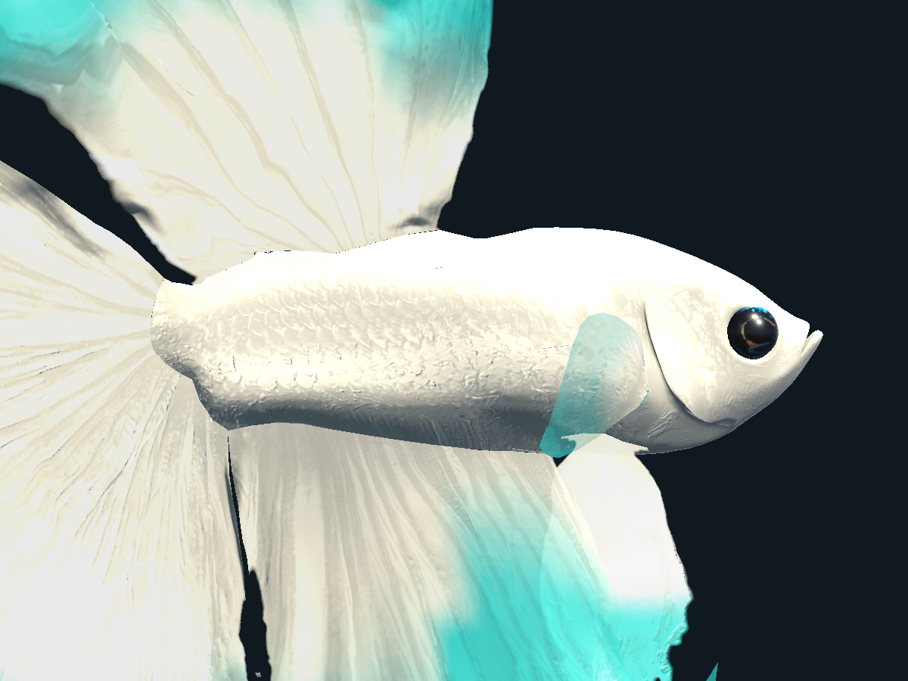
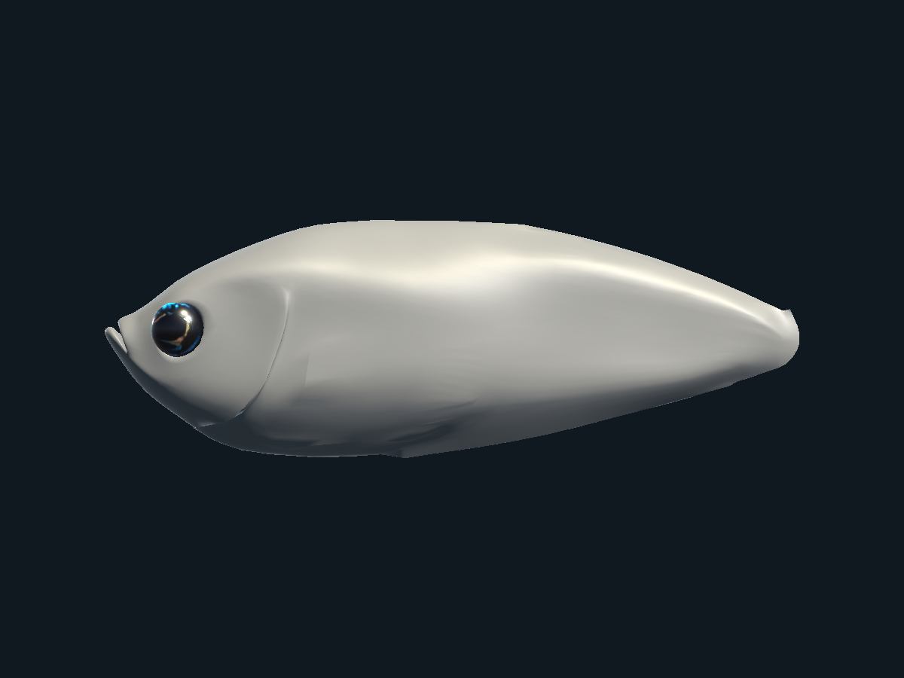

# Biến thể cá Betta

Mọi con cá dùng chung một rig (`Art/Betta/Betta.fbx`). Mỗi loại cá là một asset `BettaVariant`, gồm kiểu đuôi, hoa văn, 3 màu và tỉ lệ đầu/vây. `BettaAppearance` áp variant lên con cá lúc chạy. Thêm loại cá mới không cần sửa code hay rig lại.

*Ảnh render ngoài Unity từ `Betta.fbx` ở tư thế bind pose, dùng mask đã bake và cùng công thức màu với `BettaVariant.hlsl`. Ảnh này không thể hiện ánh sáng URP và ánh kim.*

## Cài đặt lần đầu

1. **Lumaquarium → Build Betta Prefab.** Lệnh này bake `Art/Betta/Textures/BETTA_VariantMask.png` nếu chưa có và lớp vảy `BETTA_OrderedScales.png` nếu thiếu hoặc khác phiên bản/source mesh, rồi gán vào `Betta.mat`.
2. **Lumaquarium → Build Betta Variant Presets.** Lệnh này tạo 7 kiểu đuôi, 7 hoa văn, 10 variant mẫu và `Data/Betta/BettaLibrary.asset`.
3. Trong `MainAquarium`, thêm component **Betta Appearance** vào `BettaRoot`, rồi chọn **Variant** (ví dụ `Data/Betta/Variants/KoiGalaxyPlakat`). Skeleton Root và Fin Physics có thể để trống, component tự tìm. Lệnh **Build Main Aquarium Scene** cũng tự thêm component này.

Muốn mỗi lần chơi ra một con cá khác: để trống **Variant** và gán **Library**. Khi đó `Generate Random` tắt thì component chọn một variant mẫu theo độ hiếm; bật thì nó sinh tổ hợp mới từ danh sách kiểu đuôi, hoa văn và bảng màu trong library.

## Thêm loại cá

- **Chỉ đổi màu hoặc hoa văn:** chuột phải, chọn **Create → Lumaquarium → Betta Variant**, chọn Tail, Pattern và 3 màu. Khi gán variant vào Betta Appearance, cá trong scene đổi màu ngay mà không cần Play. Sửa màu trong chính asset variant thì phải bấm Play, hoặc gán lại variant, mới thấy thay đổi.
- **Kiểu đuôi mới:** tạo **Betta Tail Type**. Vì `Betta.fbx` là dáng Halfmoon nên Halfmoon là mốc chuẩn (mọi hệ số bằng 1, độ xòe bằng 0); các kiểu khác chỉnh tương đối so với nó.
- Thêm asset mới vào `BettaLibrary` để spawner chọn được nó.

## Ba lớp

| Lớp | Ở đâu | Cách hoạt động |
|---|---|---|
| Rig | `Betta.fbx` | 80 bone và 4 clip dùng chung. Không đổi tên bone, vì `BettaFinPhysics` và `BettaSwimMotion` tìm bone theo tên. |
| Hình dáng | `BettaBodyProfile`, `BettaHeadShape`, `BettaAppearance`, `BettaFinPhysics` | Các tiết diện thân–đầu dùng chung đường bao cong liên tục: đầy phía trước, thu nhỏ về cuống đuôi và miệng. Má/cằm được làm tròn; mang khép theo má khi nghỉ và vẫn mở có giới hạn trong Flare. Tâm mắt và gốc vây đi theo hình mới; mép vây tự do giữ nguyên. Xương đầu/mang giữ scale 1, mắt chỉ scale đều theo Eye Scale. Vị trí mắt và tư thế mang được gán lại mỗi `LateUpdate` vì clip có key cho mọi bone. Độ xòe, độ rủ và physics giữ theo kiểu đuôi. |
| Màu | `Shaders/BettaVariant.hlsl` | Màu lấy từ 3 màu của variant, trộn theo mask. Da dùng lớp vảy sạch riêng; tia vây vẫn dùng texture gốc. Truyền qua `MaterialPropertyBlock`, nên mọi con cá dùng chung một material. |

### Mask `BETTA_VariantMask.png`

| Kênh | Nội dung | Cách bake |
|---|---|---|
| R | Thân = 1, vây = 0 | Theo UV island: island nào có đỉnh do bone lõi dẫn (Head, Spine, Jaw, Gill, Belly) là thân. Ở `Betta.fbx`, thân là 49%, hàm 100%, mọi vây 0%. |
| G | Gốc vây = 0, mép vây = 1 | Khoảng cách tới bone gốc của chuỗi vây, chia cho chiều dài chuỗi. Gốc và chiều dài chuỗi đo trên mọi xương của rig, vì mỗi mesh vây chỉ giữ các xương nó được skin vào. |
| B, A | Hai noise độc lập | Noise 3D theo vị trí bind pose, nên khớp qua các đường seam UV. Seed trộn hai kênh này để mỗi seed cho bộ đốm khác. |

Mask bake cả `BODY` lẫn mọi mesh `Fin_*` (mỗi kiểu đuôi có UV island riêng trong cùng atlas). Nếu `Fin_*` có UV đè lên nhau, bộ Halfmoon được bake sau cùng nên giữ phần chồng. Trước bản sửa này, mask chỉ có `BODY`, nên vùng của vây đuôi, vây lưng và vây hậu môn trống, G = 0, và mọi hoa văn tô các vây đó toàn màu gốc.

Bản mask trong repo đã được bổ sung vùng vây bằng chính `BettaMaskBaker.cs` chạy ngoài Unity trên dữ liệu `Betta.fbx`. Vùng thân giữ nguyên texel cũ: R trùng hoàn toàn, G gần như trùng. Kênh nhiễu B/A của vây được tính theo trục FBX gốc nên khác bản Unity sẽ bake. Chạy **Bake Betta Variant Mask** trong Unity sẽ tạo lại toàn bộ mask cho đồng nhất; khi đó vị trí đốm Marble/Koi trên thân cũng có thể đổi.

*Ảnh render ngoài Unity, nhìn ngang, vây phẳng, cùng công thức màu với `BettaVariant.hlsl` (Texture Detail 0.3). Không có ánh sáng URP, độ bóng và nếp gợn sóng.*

Artist có thể vẽ đè mask này theo cùng quy ước kênh. Chạy lại **Bake Betta Variant Mask** sẽ ghi đè file.

## Viền vây Crowntail và Double Tail

`Betta.fbx` chứa mesh vây riêng cho từng kiểu, dùng chung rig. Tail Type có trường **Fin Meshes** liệt kê các mesh `Fin_*` được bật, `BettaAppearance` tắt các mesh `Fin_*` còn lại. Để trống thì dùng bộ Halfmoon.

| Kiểu đuôi | Vây đuôi | Vây lưng | Vây hậu môn |
|---|---|---|---|
| Plakat, Veiltail, Delta, Halfmoon | `Fin_Caudal_Halfmoon` | `Fin_Dorsal_Halfmoon` | `Fin_Anal_Halfmoon` |
| Crowntail | `Fin_Caudal_Crowntail` | `Fin_Dorsal_Crowntail` | `Fin_Anal_Crowntail` |
| Double Tail | `Fin_Caudal_DoubleTail` | `Fin_Dorsal_DoubleTail` | `Fin_Anal_Halfmoon` |

- **Crowntail:** gai có xương riêng (`Tail_Crown_01..12`, `Dorsal_Crown_01..09`, `Anal_Crown_01..11`, mỗi chuỗi 3 xương), treo trên xương tia vây. Clip không key các xương này, `BettaFinPhysics` mô phỏng chúng như chuỗi vây ngắn: gai nhận độ dựng vây lưng, độ xòe và độ rủ từ tia vây cha. Các kiểu đuôi khác ghi các chuỗi gai trong **Skipped Fin Chains** để không tốn CPU cho xương không có mesh.
- **Double Tail:** mesh vây lưng đã to sẵn, nên Dorsal Length để 1 (để 1.25 thì sẽ phóng to hai lần). Chuỗi `Tail_` nằm trong khe giữa hai thuỳ, nên vẫn được ghi trong **Skipped Fin Chains** (`Tail_01`).

## Mép vây gợn sóng (Rosetail)

*Ảnh render ngoài Unity: mesh vây Halfmoon trong `Betta.fbx` đi qua chính `BettaFinRuffle.cs` (biên dịch bằng .NET với stub UnityEngine), cắt theo alpha của base map. Ảnh này không có ánh sáng URP.*

Rosetail dùng bộ mesh Halfmoon. Tail Type có nhóm **Ruffle**, và khi **Depth** lớn hơn 0 thì `BettaFinRuffle` tạo bản sao gợn sóng của các mesh `Fin_*` đang hiện:

- **Mép tự do** là đoạn dài nhất trên viền mesh không bị skin vào xương gốc (`*_Base`, `*_01`). Phần viền còn lại là gốc vây, chỗ dính vào thân, nên không gợn.
- Mesh được chia nhỏ 2 lần (mesh gốc chỉ có khoảng 20 đỉnh dọc mép). Mỗi đỉnh dịch ra khỏi mặt phẳng vây theo hình sin của quãng đường dọc mép. Hai trường điều hoà, giải trên mesh gốc, cho biết vị trí dọc mép và độ xa từ gốc ra mép, nên nếp gấp chạy liền tới gốc mà không bị gãy.
- Mesh được dịch ở bind pose, nên skin và `BettaFinPhysics` vẫn uốn vây như bình thường. Mỗi mesh nguồn và mỗi bộ thông số chỉ tạo một lần, mọi con cá cùng kiểu đuôi dùng chung.

| Trường | Ý nghĩa | Rosetail |
|---|---|---|
| Depth | Độ cao nếp gấp, tính theo kích thước vây. 0 là vây phẳng | 0.04 |
| Wavelength | Độ dài một nếp (lên và xuống) dọc mép, tính theo kích thước vây | 0.2 |
| Start | Nếp bắt đầu từ đâu, 0 là gốc vây, 1 là mép | 0.5 |

Vì đọc dữ liệu mesh lúc chạy, `Betta.fbx` cần bật **Read/Write** (`isReadable: 1` trong file `.meta`).

Trường **Base Map** (texture cắt alpha từ `Tools/betta_fin_cuts.py`) vẫn còn, nhưng các preset không dùng nữa: cắt alpha trên mesh thật sẽ cắt chồng lên viền của mesh.

## Bảng chuẩn

| Kiểu đuôi | Dài đuôi | Dài vây lưng | Xòe | Rủ | Fin sag / tipStiffness / maxAngle | Trọng số |
|---|---|---|---|---|---|---|
| Plakat | 0.45 | 0.6 | −6° | 0° | 0.03 / 0.09 / 15° | 30 |
| Veiltail | 1.15 | 1.1 | −12° | 14° | 0.30 / 0.03 / 25° | 25 |
| Delta | 0.9 | 0.95 | −10° | 0° | 0.12 / 0.045 / 22° | 18 |
| Halfmoon | 1 | 1 | 0° | 0° | 0.15 / 0.035 / 22° | 12 |
| Crowntail | 1 | 1 | −4° | 0° | 0.12 / 0.04 / 22° | 10 |
| Double Tail | 0.95 | 1 | 4° | 0° | 0.15 / 0.035 / 22° | 5 |
| Rosetail | 1.05 | 1.05 | 6° | 0° | 0.18 / 0.035 / 22° | 4 |

| Hoa văn | Kênh mask | 3 màu dùng thế nào | Trọng số |
|---|---|---|---|
| Solid | R, G | Chính cho thân và vây, vây ngả dần sang Phụ ở mép | 35 |
| Bicolor | R, G | Chính cho thân, Phụ cho vây | 25 |
| Butterfly | R, G | Chính ở gốc vây, Phụ ở dải mép | 15 |
| Marble | R, B, A | Phụ làm nền, Chính và Nhấn làm vệt loang | 12 |
| Koi | R, B, A | Phụ làm nền trắng, Chính làm đốm màu, Nhấn làm đốm đen | 8 |
| Dragon | R | Chính cho thân, Nhấn tô lên các vảy sáng | 5 |
| Pearl | R, G | Kiểu Butterfly với dải ở 0.6 và chuyển màu mềm (0.15): thân và nửa trong của vây màu Chính, nửa ngoài loang sang Phụ | 4 |

Butterfly và Pearl có hai trường **Butterfly Band** (vị trí dải, 0 là gốc vây, 1 là mép) và **Butterfly Band Softness** (độ rộng vùng chuyển màu; 0.04 là đường cắt gọn, càng lớn càng loang mềm).

Variant **Aqua Pearl Rosetail** (thân trắng sữa, vây trắng ở gốc và viền xanh ngọc ở nửa ngoài) dùng hoa văn Pearl trên đuôi Rosetail. Để ra trắng sữa chứ không phải trắng bạc, variant này đặt:

- **Silver Sheen** 0: bề mặt satin không kim loại, độ bóng 0.58. Mặc định 1 vẫn dùng vân ánh kim của texture nhưng độ kim loại được giảm còn 30%, độ bóng giới hạn 0.45–0.72 để không giống kim loại thô.
- **Iridescence** 0.1: chỉ còn chút bóng trên thân.
- **Texture Detail** 0.3: vân vảy và tia vây của texture gốc mờ hơn (mặc định 0.6).
- **Head Scale** 1 và **Eye Scale** 1.25: sọ rộng và đầy hơn, trán cong, mõm ngắn hơn. `BettaHeadShape` làm mềm hình học và normal của vùng má–mang trên các đỉnh đã ghép theo vị trí, rồi nối dần về thân. Mắt đi theo hình sọ bằng vị trí xương, nhãn cầu giữ tỉ lệ đều. Xương đầu và mang không bị phóng độc lập. Mesh nguồn, UV và trọng số skin được giữ nguyên; cache tối đa 26 mức trong khoảng Head Scale 0.8–1.3.

## Da và màng vây dùng chung

`Betta.mat` hiện dùng normal strength 0.065 và AO strength 0.18 để vảy dịu hơn. `BettaPrefabBuilder` đã đồng bộ hai giá trị này để build lại không trả da về cấu hình 0.22/0.35 trước đây.

`BettaFinSurface` tách tam giác BODY thành hai submesh theo UV island: da đục và màng vây ngực/bụng có alpha blend. Các mesh `Fin_*` cũng dùng màng vây với normal strength 0.12, alpha cut 0.08, không ghi depth và không dùng alpha-to-coverage. Cách phân vùng được dùng chung với `BettaMaskBaker`; các mảng bụng do xương gốc vây dẫn vẫn là da đục. `Resources/BettaMembrane.mat` giữ shader variant trong bản player build. Ảnh tiệm cá được bake lại với alpha thẳng để UI không làm vây tối thêm lần nữa.

`BettaFinPhysics.maxAngle` hiện giới hạn tổng độ uốn bổ sung trên cả đường từ gốc đến ngọn, kể cả nhánh vây ngực và tia Crowntail. Các tia lân cận dùng sóng có pha gần nhau; ngọn trễ hơn gốc. Rosetail dùng ruffle depth 0.015, wavelength 0.3, start 0.6 để nếp gợn nhẹ hơn. Chuyển động mang mặc định 1.2°, recoil đầu 0.6°; scene MainAquarium đã lưu các giá trị này.

Các file của lần chỉnh theo mẫu video: `BettaHeadShape.cs`, `BettaAppearance.cs`, `BettaFinSurface.cs`, `BettaFinPhysics.cs`, `BettaFinRuffle.cs`, `BettaSwimMotion.cs`; shader `BettaVariant.hlsl`; các editor builder/baker `BettaPrefabBuilder.cs`, `BettaVariantPresets.cs`, `BettaMaskBaker.cs`, `FishShopScreenBuilder.cs`. Asset đã lưu gồm `Art/Betta/Betta.mat`, `Resources/BettaMembrane.mat`, `Data/Betta/Tails/Rosetail.asset`, `Scenes/MainAquarium.unity` (hai thông số recoil/mang) và năm ảnh `UI/Portraits/Shop/*.png`. Các đường dẫn asset/code đều tương đối với `Assets/_Project/`.

Ảnh kiểm tra thêm: [góc trước](previews/BettaNaturalModel/front.png), [tư thế khi đang bơi](previews/BettaNaturalModel/swimming.png), [Game View dọc](previews/BettaNaturalModel/game.png). Không đổi FBX nguồn; hình học chung được tạo trên bản sao mesh, dùng lại qua cache khi cá được áp variant.

## Form đầu–mang–thân liền nhau

`BettaBodyProfile.cs` dựng đường bao từ các tiết diện đo trên BODY nguồn, nội suy đơn điệu để tránh lõm trước đầu. Thân có khối bầu dục, đầy ở phần trước rồi thu nhỏ dần về cuống đuôi; lưng nối qua trán và thuôn về miệng. `BettaHeadShape.cs` áp cùng phép biến đổi cho má/cằm và vùng gốc vây, pha mềm ra mép vây. `BettaAppearance.cs` giữ mang theo khối đầu khi nghỉ, với góc mở Flare tối đa 8° mỗi bên. Năm ảnh tiệm cá đã được bake lại. Lần chỉnh này tập trung vào form chung, giữ FBX, UV, topology và trọng số skin nguồn.

Ảnh kiểm tra hình khối: [nhìn ngang](previews/BettaOvalProfile/side.png), [góc chéo](previews/BettaOvalProfile/three-quarter.png), [vật liệu xám](previews/BettaOvalProfile/clay.png), [tư thế bơi](previews/BettaOvalProfile/swimming.png).

### Thân thấp và bầu tròn hơn theo ảnh mẫu

`BettaBodyProfile.cs` hạ và trải đỉnh lưng, bổ sung đường bao chiều rộng riêng, vuốt bụng và phần sau về cuống đuôi. Tại cùng tiết diện thân trước, tỉ lệ rộng/cao tăng từ khoảng 0.39 lên 0.55. `BettaHeadShape.cs` làm mềm các gờ trên đảo UV da thân bằng phép thư giãn đã dùng cho má; các đỉnh nối chung với mesh vây riêng và các tam giác nối rất mảnh được giữ cố định để không hở hoặc lật mặt. Mắt, miệng, mesh nguồn, topology và trọng số skin được giữ nguyên. Năm ảnh tiệm cá đã được cập nhật lại.

Ảnh kiểm tra: [góc chéo](previews/BettaRoundedBody/three-quarter.png), [thân xám nhìn ngang](previews/BettaRoundedBody/clay-side.png), [nhìn từ trên](previews/BettaRoundedBody/clay-top.png), [chính diện](previews/BettaRoundedBody/clay-front.png), [đang bơi](previews/BettaRoundedBody/swimming.png). [Số đo tiết diện](previews/BettaRoundedBody/measurements.json) lấy từ mesh bind pose, chuẩn hóa theo khoảng Head–Tail_Base. Độ dày ngang là lựa chọn tạo hình có kiểm tra ba góc; ảnh mẫu chỉ có góc ngang nên không cung cấp số đo 3D chính xác.

### Lưng–bụng theo mẫu tượng cá xám

Da lưng/bụng trong FBX có nhiều đỉnh chịu ảnh hưởng của xương tia vây. Ở bản trước, xoay/phóng `Dorsal_A_01` kéo da thân tới khoảng 18 mm dù đường bao bind pose đã mềm. `BettaBodySkinning.cs` chuyển ảnh hưởng này sang hai xương thân lân cận trên bản sao BODY; vùng gốc màng vây pha vào cùng xương thân, mép tự do giữ trọng số gốc. `BettaHeadShape.cs` áp trọng số mới cho các mesh đã fit. FBX và trọng số nguồn không bị ghi đè.

`BettaBodyProfile.cs` dùng đường bao ngoài da thân đo mỗi 5 mm để nắn cả các thùy nhỏ ở gốc vây, đồng thời thu nhỏ cuống đuôi. `BettaFinRuffle.cs` vẫn nhận diện gốc bằng trọng số tác giả và giữ cả các điểm nối nằm trong màng vây cố định khi tạo nếp Rosetail. Năm ảnh tiệm cá đã bake lại.

Ảnh kiểm tra: [góc chéo xám](previews/BettaReferenceBody/clay-quarter.png), [góc trên](previews/BettaReferenceBody/clay-top.png), [màu thật](previews/BettaReferenceBody/color-side.png), [đang bơi](previews/BettaReferenceBody/swimming.png). `docs/tests/betta-body-fin-isolation.cs` và `docs/tests/betta-ruffled-attachments.cs` lần lượt kiểm tra vây thường và Rosetail thật: xoay/phóng 15 xương vây, mỗi phép kiểm có 735 mẫu điểm nối, thân không bị kéo và không mở khe nối. `betta-head-shape.cs` kiểm tra trọng số bản sao được chuẩn hóa, trọng số nguồn và mép vây xa vẫn nguyên.

Hiệu chỉnh tiếp theo mẫu nhìn chéo: `BettaBodyProfile.cs` tăng khối thân sau và chiều rộng, giữ chiều cao thân trước. Tại tiết diện thân trước, rộng/cao tăng khoảng 0.55 → 0.64; phần sau tăng 0.34 → 0.42. Gần cuống đuôi, chiều cao tăng khoảng 33% và chiều rộng khoảng 49% so với bản vừa thu nhỏ. Vùng chuyển tiếp hình học được nới để phần rộng hơn không gập lại ở gốc vây; không đổi skinning hay rig. Năm ảnh tiệm cá đã cập nhật. Ảnh mới: [ngang](previews/BettaFullerRear/clay-side.png), [nhìn chéo](previews/BettaFullerRear/clay-quarter.png), [nhìn từ trên](previews/BettaFullerRear/clay-top.png), [đang bơi](previews/BettaFullerRear/swimming.png); [số đo](previews/BettaFullerRear/measurements.json). Các tỉ lệ là số đo model, không phải số đo suy ra chính xác từ ảnh mẫu nhìn chéo.

### Độ cong bề mặt và da dịu hơn

`BettaBodyProfile.cs` bổ sung phép làm tròn tiết diện vào cùng trường biến dạng dùng cho thân và gốc vây. Phép chỉnh pha 72% về tiết diện bầu dục, giữ độ sâu tương đối giữa các lớp mang, giảm tác động ở miệng và ngoài vùng da. Chiều rộng/cao mục tiêu không đổi; lần này xử lý các mảng phẳng ở má và gờ bụng/cuống đuôi thay vì tiếp tục tăng kích thước. `BettaVariant.hlsl` giảm tương phản bóng tối có sẵn trong màu da, hạ smoothness nền 0.58 → 0.40 và giới hạn ánh ngọc ở 0.58. `Betta.mat` giảm normal strength 0.22 → 0.065 và occlusion 0.35 → 0.18.

Ảnh cùng điều kiện kiểm tra: [xám trước](previews/BettaSmoothSurface/before-clay.png), [xám sau](previews/BettaSmoothSurface/clay-quarter.png), [chính diện](previews/BettaSmoothSurface/clay-front.png), [từ trên](previews/BettaSmoothSurface/clay-top.png), [da trước](previews/BettaSmoothSurface/before-skin.png), [da sau](previews/BettaSmoothSurface/skin-quarter.png), [cá đủ vây](previews/BettaSmoothSurface/fish-quarter.png), [tư thế bơi](previews/BettaSmoothSurface/swimming.png). Các ảnh xám ẩn màng/vây để lộ thân; mắt giữ vật liệu gốc.

`docs/tests/betta-surface-curvature.cs` cắt trực tiếp tam giác da tại 10 vị trí và ba mức Head Scale. Sai lệch bán kính RMS so với ellipse đã chuẩn hóa giảm ở thân khoảng 0.0474 → 0.0152, má/vai 0.0810 → 0.0235. Đây là chỉ số độ đều tiết diện, không phải phần trăm giống cá thật. Test tái hiện lỗi trước khi sửa và qua sau khi sửa; [số đo](previews/BettaSmoothSurface/measurements.json) lưu 30 tiết diện. Các kiểm tra đầu, silhouette, độ đầy thân, mặt lưới, Jacobian, nối vây thường/Rosetail và 10 variant × 5 clip đều qua. Shader không có thông báo lỗi. Năm ảnh tiệm cá được bake lại. Chưa build hay kiểm tra trên điện thoại.

Độ hiếm của một variant = trọng số đuôi × trọng số hoa văn / 10000. Trên 8% là Common, trên 3% là Uncommon, trên 0.8% là Rare, còn lại là Legendary.

### Đầu–mang và phân bố thân theo clip Candy Nemo Halfmoon

Tham khảo clip Tropicflow Aquatic `https://www.tiktok.com/@tropicflowsd/video/7698678295705029918`. `BettaBodyProfile.cs` đưa khối đầy ngang về vai ngay sau mang, bổ sung cung bụng trước và nâng bụng sau dần về cuống đuôi. Phần trán thấp và má/cằm đầy hơn, mõm rút 1.8 mm trong không gian bind chuẩn của model. Miệng và vùng quanh mắt dùng cùng trường biến dạng để không tách khỏi đầu. Mép mang, jaw rig và các lớp da nguồn được giữ; không đổi kiểu vây, texture hay thông số vật liệu của lượt này. Đây là diễn giải hình khối theo clip, không phải số đo giải phẫu chính xác lấy từ video.

Ảnh: [trước](previews/BettaClipForm/before-clay.png), [xám mới](previews/BettaClipForm/clay-quarter.png), [ngang](previews/BettaClipForm/clay-side.png), [từ trên](previews/BettaClipForm/clay-top.png), [chính diện](previews/BettaClipForm/clay-front.png), [đủ vây](previews/BettaClipForm/fish-quarter.png), [tư thế bơi](previews/BettaClipForm/swimming.png). [Số đo trước](previews/BettaClipForm/measurements-before.json) và [sau](previews/BettaClipForm/measurements.json) lưu theo chiều dài Head–Tail_Base; tọa độ mõm lưu bằng mét.

`docs/tests/betta-clip-head-body.cs` tái hiện các điểm cần chỉnh trên model thật trước khi sửa; 12 kiểm tra vai/bụng/mõm ở ba Head Scale qua sau sửa. Kiểm tra 30 tiết diện tròn, 60 điều kiện tỉ lệ, 66 kiểm tra đầu, 122 kiểm tra silhouette, 21.204 mẫu Jacobian (định thức nhỏ nhất 0.129779), mặt thân và 49 điểm nối chung đều qua. Prefab được build lại bằng builder đã đồng bộ da mới; năm ảnh tiệm cá được cập nhật. File scene và số lượng 597 đối tượng giữ nguyên.

### Vảy xếp hàng theo clip

`Editor/BettaScaleBaker.cs` tạo atlas 2048 × 2048 bằng tọa độ bề mặt bind của BODY, dùng các tiết diện thật để hàng vảy quấn quanh thân. Các vảy bầu dục xếp chồng, hàng so le nửa bước; 32 hàng quanh thân, thu nhỏ về đầu và cuống đuôi. Đây là họa tiết tạo bằng code, không phải bản sao chính xác của cá trong clip. UV và mesh nguồn không bị chỉnh sửa. Atlas `BETTA_OrderedScales.png` chứa R = chi tiết màu nhẹ, GB = normal tangent XY, A = vùng da đục. Texture dùng dữ liệu linear và mipmap; metadata lưu phiên bản bake cùng hash nguồn FBX để builder không dùng lại lớp vảy cũ khi nguồn thay đổi.

`BettaVariant.hlsl` thay normal/AO nhăn trên da bằng chi tiết vảy nông, giảm mạnh bóng tối có sẵn trong màu da nguồn và dùng phản sáng dịu hơn. Màu/pattern variant vẫn được giữ; mắt và tia vây tiếp tục dùng texture cũ. `BettaPrefabBuilder` gán atlas mới vào cả asset material và template màng vây, nhưng mask không cho vảy xuất hiện trên màng. `BettaMaskBaker.Dilate` được dùng chung để chống viền UV.

Ảnh: [trước](previews/BettaOrderedScales/before-fish.png), [vảy mới cận cảnh](previews/BettaOrderedScales/skin-quarter.png), [ngang](previews/BettaOrderedScales/skin-side.png), [từ trên](previews/BettaOrderedScales/skin-top.png), [đang bơi](previews/BettaOrderedScales/swimming-skin.png), [cá đủ vây](previews/BettaOrderedScales/fish-quarter.png), [mẫu Koi](previews/BettaOrderedScales/koi-skin.png). Ảnh render cùng quy trình, không chỉnh sửa hậu kỳ.

`docs/tests/betta-ordered-scales.cs` kiểm tra atlas trên mesh thật: 8.488 mẫu da, 4.130 mẫu màng/vây; không có vảy lan lên vây. Test builder hiện có 10 điều kiện qua hai lần chạy, bao gồm giữ tham chiếu atlas mới. Shader biên dịch không báo lỗi; 12 kiểm tra form theo clip và 66 kiểm tra đầu/variant qua sau rebuild. Năm chân dung tiệm cá được cập nhật. Scene hồ giữ nguyên.

## Build lại trong Unity

Thoát Play Mode rồi dùng `Lumaquarium > Build Betta Prefab`. Builder lưu prefab, controller và hai vật liệu liên quan; lệnh bị vô hiệu khi đang Play để không thay dữ liệu giữa lượt chạy. Form mới vẫn được tạo từ code hiện tại khi `BettaAppearance` áp variant, không có mesh tạo hình cũ được bake vào FBX.

Lệnh `Build Main Aquarium Scene` của generator starter đã gỡ khỏi menu vì nó ghi đè hồ, HUD và cấu hình cá hiện tại. Code starter được giữ cho thiết lập ban đầu; các bản sao lưu scene không bị xóa. Lượt rebuild này giữ nguyên file scene và 597 đối tượng trong scene, không reset variant presets. `docs/tests/betta-builder-current-skin.cs` kiểm tra hai lần chạy builder vật liệu liên tiếp, 10 điều kiện đều qua; kiểm tra form đầu/variant và điểm nối cũng qua sau rebuild. Đây là rebuild asset trong Editor, không phải APK hay bản iOS.

## Giới hạn hiện tại

- Dáng đầu chung đã được kiểm tra trên 10 biến thể trong Unity, đổi qua lại không tăng biến dạng. Năm clip được lấy mẫu trong Play Mode để kiểm tra mắt và đường nối da; đây chưa phải đánh giá mỹ thuật cho mọi khung hình chuyển động.
- Chạy các phép kiểm bằng `unity command eval_file --caller plugin --skill unity-cli --format json -- --file <file> --timeout 15000`: Edit Mode có `docs/tests/betta-head-shape.cs` (66 checks) và `docs/tests/betta-natural-model.cs`; Play Mode có `docs/tests/betta-head-animation.cs` (150 checks) và `docs/tests/betta-fin-continuity.cs` (48 đường xương gồm cả các nhánh).
- Form mới có thêm `docs/tests/betta-oval-silhouette.cs` (122 kiểm tra trên 10 biến thể: đường bao, độ đầy thân, mang nghỉ/Flare) và `docs/tests/betta-profile-jacobian.cs` (21.204 mẫu trên BODY và vây ở ba mức Head Scale; định thức nhỏ nhất 0.1003, không lật tiết diện).
- `docs/tests/betta-rounded-body.cs` kiểm tra 60 điều kiện về độ cao lưng, độ đầy ngang và độ thuôn trên 10 biến thể. `docs/tests/betta-body-integrity.cs` kiểm tra 4.700 mặt da thân và 49 đỉnh nối chung thân–vây ở ba mức Head Scale, kể cả prefab chưa kích hoạt: không có mặt thân quay ngược hoặc đỉnh nối bị tách. Các mesh không có đỉnh trùng nguồn được kiểm tra bằng ảnh render thay vì phép đo đỉnh nối này.
- Đã đối chiếu ba góc của model và các tư thế đang bơi trong Unity. Chưa kiểm tra bản player trên điện thoại. Alpha blend có thể khác đôi chút khi nhiều màng vây chồng lên nhau hoặc với cấu hình renderer khác.
- Thuộc tính variant nằm ngoài `UnityPerMaterial`, nên Betta Lit không dùng được SRP Batcher. Với số cá trong một bể thì không đáng kể.
