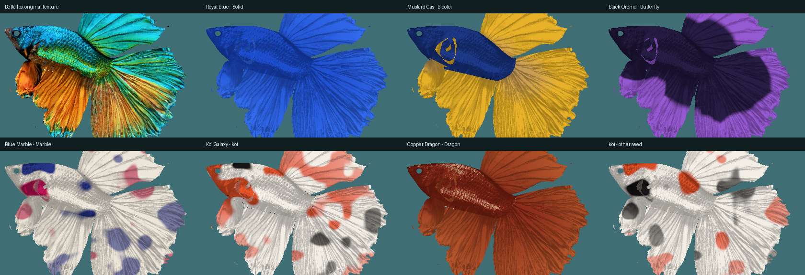
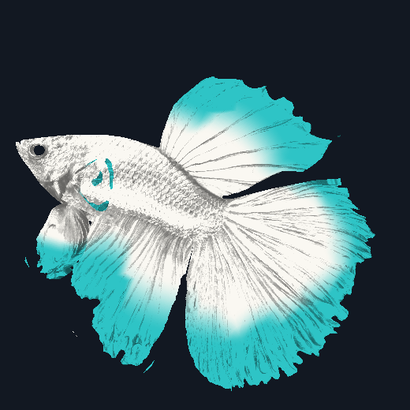
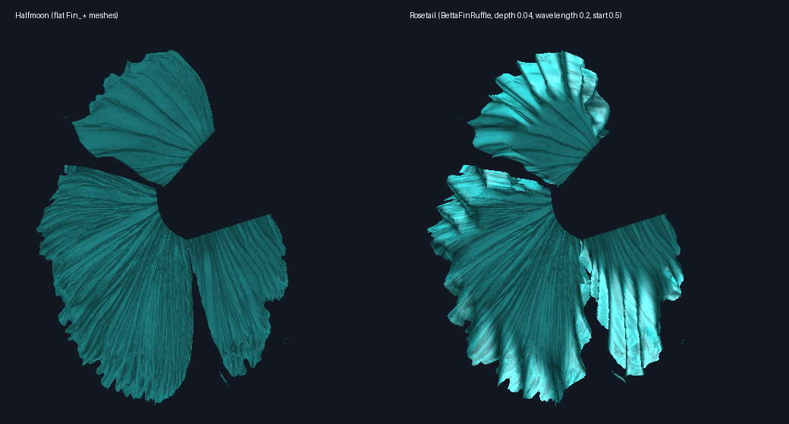

# Biến thể cá Betta

Mọi con cá dùng chung một rig (`Art/Betta/Betta.fbx`). Mỗi loại cá là một asset `BettaVariant`, gồm kiểu đuôi, hoa văn, 3 màu và tỉ lệ đầu/vây. `BettaAppearance` áp variant lên con cá lúc chạy. Thêm loại cá mới không cần sửa code hay rig lại.

*Ảnh render ngoài Unity từ `Betta.fbx` ở tư thế bind pose, dùng mask đã bake và cùng công thức màu với `BettaVariant.hlsl`. Ảnh này không thể hiện ánh sáng URP và ánh kim.*

## Cài đặt lần đầu

1. **Lumaquarium → Build Betta Prefab.** Lệnh này bake `Art/Betta/Textures/BETTA_VariantMask.png` nếu chưa có, rồi gán mask vào `Betta.mat`.
2. **Lumaquarium → Build Betta Variant Presets.** Lệnh này tạo 7 kiểu đuôi, 7 hoa văn, 10 variant mẫu và `Data/Betta/BettaLibrary.asset`.
3. Trong `MainAquarium`, thêm component **Betta Appearance** vào `BettaRoot`, rồi chọn **Variant** (ví dụ `Data/Betta/Variants/KoiGalaxyPlakat`). Skeleton Root và Fin Physics có thể để trống, component tự tìm. Lệnh **Build Main Aquarium Scene** cũng tự thêm component này.

Muốn mỗi lần chơi ra một con cá khác: để trống **Variant** và gán **Library**. Khi đó `Generate Random` tắt thì component chọn một variant mẫu theo độ hiếm; bật thì nó sinh tổ hợp mới từ danh sách kiểu đuôi, hoa văn và bảng màu trong library.

## Thêm loại cá

- **Chỉ đổi màu hoặc hoa văn:** chuột phải, chọn **Create → Lumaquarium → Betta Variant**, chọn Tail, Pattern và 3 màu. Khi gán variant vào Betta Appearance, cá trong scene đổi màu ngay mà không cần Play. Sửa màu trong chính asset variant thì phải bấm Play, hoặc gán lại variant, mới thấy thay đổi.
- **Kiểu đuôi mới:** tạo **Betta Tail Type**. Vì `Betta.fbx` là dáng Halfmoon nên Halfmoon là mốc chuẩn (mọi hệ số bằng 1, độ xòe bằng 0); các kiểu khác chỉnh tương đối so với nó.
- Thêm asset mới vào `BettaLibrary` để spawner chọn được nó.

## Ba lớp

| Lớp | Ở đâu | Cách hoạt động |
|---|---|---|
| Rig | `Betta.fbx` | 80 bone và 4 clip dùng chung. Không đổi tên bone, vì `BettaFinPhysics` và `BettaSwimMotion` tìm bone theo tên. |
| Hình dáng | `BettaAppearance`, `BettaFinPhysics` | Scale bone `Head`, `Gill_*_01` và gốc các chuỗi vây, gán lại mỗi `LateUpdate` vì clip có key scale cho mọi bone. Độ xòe và độ rủ của đuôi xoay gốc các chuỗi `Tail_*`. Mỗi kiểu đuôi có preset fin physics riêng. |
| Màu | `Shaders/BettaVariant.hlsl` | Texture gốc chỉ còn giữ độ sáng tối (vảy, tia vây, AO). Màu lấy từ 3 màu của variant, trộn theo mask. Truyền qua `MaterialPropertyBlock`, nên mọi con cá dùng chung một material. |

### Mask `BETTA_VariantMask.png`

| Kênh | Nội dung | Cách bake |
|---|---|---|
| R | Thân = 1, vây = 0 | Theo UV island: island nào có đỉnh do bone lõi dẫn (Head, Spine, Jaw, Gill, Belly) là thân. Ở `Betta.fbx`, thân là 49%, hàm 100%, mọi vây 0%. |
| G | Gốc vây = 0, mép vây = 1 | Khoảng cách tới bone gốc của chuỗi vây, chia cho chiều dài chuỗi. Gốc và chiều dài chuỗi đo trên mọi xương của rig, vì mỗi mesh vây chỉ giữ các xương nó được skin vào. |
| B, A | Hai noise độc lập | Noise 3D theo vị trí bind pose, nên khớp qua các đường seam UV. Seed trộn hai kênh này để mỗi seed cho bộ đốm khác. |

Mask bake cả `BODY` lẫn mọi mesh `Fin_*` (mỗi kiểu đuôi có UV island riêng trong cùng atlas). Nếu `Fin_*` có UV đè lên nhau, bộ Halfmoon được bake sau cùng nên giữ phần chồng. Trước bản sửa này, mask chỉ có `BODY`, nên vùng của vây đuôi, vây lưng và vây hậu môn trống, G = 0, và mọi hoa văn tô các vây đó toàn màu gốc.

Bản mask trong repo đã được bổ sung vùng vây bằng chính `BettaMaskBaker.cs` chạy ngoài Unity trên dữ liệu `Betta.fbx`. Vùng thân giữ nguyên texel cũ: R trùng hoàn toàn, G gần như trùng. Kênh nhiễu B/A của vây được tính theo trục FBX gốc nên khác bản Unity sẽ bake. Chạy **Bake Betta Variant Mask** trong Unity sẽ tạo lại toàn bộ mask cho đồng nhất; khi đó vị trí đốm Marble/Koi trên thân cũng có thể đổi.

*Ảnh render ngoài Unity, nhìn ngang, vây phẳng, cùng công thức màu với `BettaVariant.hlsl` (Texture Detail 0.3). Không có ánh sáng URP, độ bóng và nếp gợn sóng.*

Artist có thể vẽ đè mask này theo cùng quy ước kênh. Chạy lại **Bake Betta Variant Mask** sẽ ghi đè file.

## Viền vây Crowntail và Double Tail

`Betta.fbx` chứa mesh vây riêng cho từng kiểu, dùng chung rig. Tail Type có trường **Fin Meshes** liệt kê các mesh `Fin_*` được bật, `BettaAppearance` tắt các mesh `Fin_*` còn lại. Để trống thì dùng bộ Halfmoon.

| Kiểu đuôi | Vây đuôi | Vây lưng | Vây hậu môn |
|---|---|---|---|
| Plakat, Veiltail, Delta, Halfmoon | `Fin_Caudal_Halfmoon` | `Fin_Dorsal_Halfmoon` | `Fin_Anal_Halfmoon` |
| Crowntail | `Fin_Caudal_Crowntail` | `Fin_Dorsal_Crowntail` | `Fin_Anal_Crowntail` |
| Double Tail | `Fin_Caudal_DoubleTail` | `Fin_Dorsal_DoubleTail` | `Fin_Anal_Halfmoon` |

- **Crowntail:** gai có xương riêng (`Tail_Crown_01..12`, `Dorsal_Crown_01..09`, `Anal_Crown_01..11`, mỗi chuỗi 3 xương), treo trên xương tia vây. Clip không key các xương này, `BettaFinPhysics` mô phỏng chúng như chuỗi vây ngắn: gai nhận độ dựng vây lưng, độ xòe và độ rủ từ tia vây cha. Các kiểu đuôi khác ghi các chuỗi gai trong **Skipped Fin Chains** để không tốn CPU cho xương không có mesh.
- **Double Tail:** mesh vây lưng đã to sẵn, nên Dorsal Length để 1 (để 1.25 thì sẽ phóng to hai lần). Chuỗi `Tail_` nằm trong khe giữa hai thuỳ, nên vẫn được ghi trong **Skipped Fin Chains** (`Tail_01`).

## Mép vây gợn sóng (Rosetail)

*Ảnh render ngoài Unity: mesh vây Halfmoon trong `Betta.fbx` đi qua chính `BettaFinRuffle.cs` (biên dịch bằng .NET với stub UnityEngine), cắt theo alpha của base map. Ảnh này không có ánh sáng URP.*

Rosetail dùng bộ mesh Halfmoon. Tail Type có nhóm **Ruffle**, và khi **Depth** lớn hơn 0 thì `BettaFinRuffle` tạo bản sao gợn sóng của các mesh `Fin_*` đang hiện:

- **Mép tự do** là đoạn dài nhất trên viền mesh không bị skin vào xương gốc (`*_Base`, `*_01`). Phần viền còn lại là gốc vây, chỗ dính vào thân, nên không gợn.
- Mesh được chia nhỏ 2 lần (mesh gốc chỉ có khoảng 20 đỉnh dọc mép). Mỗi đỉnh dịch ra khỏi mặt phẳng vây theo hình sin của quãng đường dọc mép. Hai trường điều hoà, giải trên mesh gốc, cho biết vị trí dọc mép và độ xa từ gốc ra mép, nên nếp gấp chạy liền tới gốc mà không bị gãy.
- Mesh được dịch ở bind pose, nên skin và `BettaFinPhysics` vẫn uốn vây như bình thường. Mỗi mesh nguồn và mỗi bộ thông số chỉ tạo một lần, mọi con cá cùng kiểu đuôi dùng chung.

| Trường | Ý nghĩa | Rosetail |
|---|---|---|
| Depth | Độ cao nếp gấp, tính theo kích thước vây. 0 là vây phẳng | 0.04 |
| Wavelength | Độ dài một nếp (lên và xuống) dọc mép, tính theo kích thước vây | 0.2 |
| Start | Nếp bắt đầu từ đâu, 0 là gốc vây, 1 là mép | 0.5 |

Vì đọc dữ liệu mesh lúc chạy, `Betta.fbx` cần bật **Read/Write** (`isReadable: 1` trong file `.meta`).

Trường **Base Map** (texture cắt alpha từ `Tools/betta_fin_cuts.py`) vẫn còn, nhưng các preset không dùng nữa: cắt alpha trên mesh thật sẽ cắt chồng lên viền của mesh.

## Bảng chuẩn

| Kiểu đuôi | Dài đuôi | Dài vây lưng | Xòe | Rủ | Fin sag / tipStiffness / maxAngle | Trọng số |
|---|---|---|---|---|---|---|
| Plakat | 0.45 | 0.6 | −6° | 0° | 0.03 / 0.09 / 15° | 30 |
| Veiltail | 1.15 | 1.1 | −12° | 14° | 0.30 / 0.03 / 25° | 25 |
| Delta | 0.9 | 0.95 | −10° | 0° | 0.12 / 0.045 / 22° | 18 |
| Halfmoon | 1 | 1 | 0° | 0° | 0.15 / 0.035 / 22° | 12 |
| Crowntail | 1 | 1 | −4° | 0° | 0.12 / 0.04 / 22° | 10 |
| Double Tail | 0.95 | 1 | 4° | 0° | 0.15 / 0.035 / 22° | 5 |
| Rosetail | 1.05 | 1.05 | 6° | 0° | 0.18 / 0.035 / 22° | 4 |

| Hoa văn | Kênh mask | 3 màu dùng thế nào | Trọng số |
|---|---|---|---|
| Solid | R, G | Chính cho thân và vây, vây ngả dần sang Phụ ở mép | 35 |
| Bicolor | R, G | Chính cho thân, Phụ cho vây | 25 |
| Butterfly | R, G | Chính ở gốc vây, Phụ ở dải mép | 15 |
| Marble | R, B, A | Phụ làm nền, Chính và Nhấn làm vệt loang | 12 |
| Koi | R, B, A | Phụ làm nền trắng, Chính làm đốm màu, Nhấn làm đốm đen | 8 |
| Dragon | R | Chính cho thân, Nhấn tô lên các vảy sáng | 5 |
| Pearl | R, G | Kiểu Butterfly với dải ở 0.6 và chuyển màu mềm (0.15): thân và nửa trong của vây màu Chính, nửa ngoài loang sang Phụ | 4 |

Butterfly và Pearl có hai trường **Butterfly Band** (vị trí dải, 0 là gốc vây, 1 là mép) và **Butterfly Band Softness** (độ rộng vùng chuyển màu; 0.04 là đường cắt gọn, càng lớn càng loang mềm).

Variant **Aqua Pearl Rosetail** (thân trắng sữa, vây trắng ở gốc và viền xanh ngọc ở nửa ngoài) dùng hoa văn Pearl trên đuôi Rosetail. Để ra trắng sữa chứ không phải trắng bạc, variant này đặt:

- **Silver Sheen** 0: bỏ độ kim loại (0.18) và độ bóng (0.77) mà `BETTA_MetallicSmoothness.png` cho cả thân lẫn vây, thay bằng bề mặt satin không kim loại (độ bóng 0.5). Mặc định 1, giữ như texture.
- **Iridescence** 0.1: chỉ còn chút bóng trên thân.
- **Texture Detail** 0.3: vân vảy và tia vây của texture gốc mờ hơn (mặc định 0.6).

Độ hiếm của một variant = trọng số đuôi × trọng số hoa văn / 10000. Trên 8% là Common, trên 3% là Uncommon, trên 0.8% là Rare, còn lại là Legendary.

## Giới hạn hiện tại

- Mesh Double Tail và Crowntail mới được xem trong Blender, chưa kiểm tra khi chạy trong Unity, và chưa thử đổi kiểu đuôi lúc đang chạy game.
- Mép gợn sóng Rosetail mới được kiểm tra ngoài Unity, chưa chạy trong Unity.
- Các giá trị độ xòe, độ rủ và fin physics là điểm khởi đầu. Cần chỉnh lại sau khi xem cá bơi trong Unity.
- Thuộc tính variant nằm ngoài `UnityPerMaterial`, nên Betta Lit không dùng được SRP Batcher. Với số cá trong một bể thì không đáng kể.
