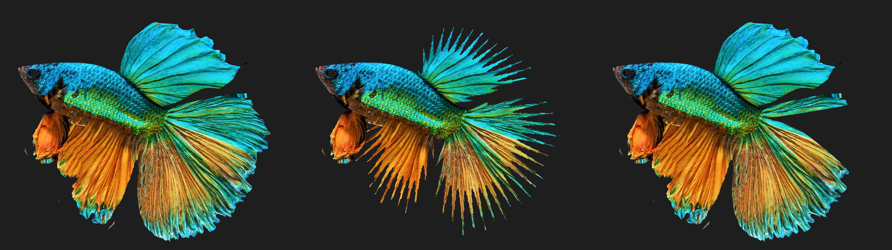

# Biến thể cá Betta

Mọi con cá dùng chung một rig (`Art/Betta/Betta.fbx`). Mỗi loại cá là một asset `BettaVariant`, gồm kiểu đuôi, hoa văn, 3 màu và tỉ lệ đầu/vây. `BettaAppearance` áp variant lên con cá lúc chạy. Thêm loại cá mới không cần sửa code hay rig lại.

*Ảnh render ngoài Unity từ `Betta.fbx` ở tư thế bind pose, dùng mask đã bake và cùng công thức màu với `BettaVariant.hlsl`. Ảnh này không thể hiện ánh sáng URP và ánh kim.*

## Cài đặt lần đầu

1. **Lumaquarium → Build Betta Prefab.** Lệnh này bake `Art/Betta/Textures/BETTA_VariantMask.png` nếu chưa có, rồi gán mask vào `Betta.mat`.
2. **Lumaquarium → Build Betta Variant Presets.** Lệnh này tạo 6 kiểu đuôi, 6 hoa văn, 9 variant mẫu và `Data/Betta/BettaLibrary.asset`.
3. Trong `MainAquarium`, thêm component **Betta Appearance** vào `BettaRoot`, rồi chọn **Variant** (ví dụ `Data/Betta/Variants/KoiGalaxyPlakat`). Skeleton Root và Fin Physics có thể để trống, component tự tìm. Lệnh **Build Main Aquarium Scene** cũng tự thêm component này.

Muốn mỗi lần chơi ra một con cá khác: để trống **Variant** và gán **Library**. Khi đó `Generate Random` tắt thì component chọn một variant mẫu theo độ hiếm; bật thì nó sinh tổ hợp mới từ danh sách kiểu đuôi, hoa văn và bảng màu trong library.

## Thêm loại cá

- **Chỉ đổi màu hoặc hoa văn:** chuột phải, chọn **Create → Lumaquarium → Betta Variant**, chọn Tail, Pattern và 3 màu. Khi gán variant vào Betta Appearance, cá trong scene đổi màu ngay mà không cần Play. Sửa màu trong chính asset variant thì phải bấm Play, hoặc gán lại variant, mới thấy thay đổi.
- **Kiểu đuôi mới:** tạo **Betta Tail Type**. Vì `Betta.fbx` là dáng Halfmoon nên Halfmoon là mốc chuẩn (mọi hệ số bằng 1, độ xòe bằng 0); các kiểu khác chỉnh tương đối so với nó.
- Thêm asset mới vào `BettaLibrary` để spawner chọn được nó.

## Ba lớp

| Lớp | Ở đâu | Cách hoạt động |
|---|---|---|
| Rig | `Betta.fbx` | 80 bone và 4 clip dùng chung. Không đổi tên bone, vì `BettaFinPhysics` và `BettaSwimMotion` tìm bone theo tên. |
| Hình dáng | `BettaAppearance`, `BettaFinPhysics` | Scale bone `Head`, `Gill_*_01` và gốc các chuỗi vây, gán lại mỗi `LateUpdate` vì clip có key scale cho mọi bone. Độ xòe và độ rủ của đuôi xoay gốc các chuỗi `Tail_*`. Mỗi kiểu đuôi có preset fin physics riêng. |
| Màu | `Shaders/BettaVariant.hlsl` | Texture gốc chỉ còn giữ độ sáng tối (vảy, tia vây, AO). Màu lấy từ 3 màu của variant, trộn theo mask. Truyền qua `MaterialPropertyBlock`, nên mọi con cá dùng chung một material. |

### Mask `BETTA_VariantMask.png`

| Kênh | Nội dung | Cách bake |
|---|---|---|
| R | Thân = 1, vây = 0 | Theo UV island: island nào có đỉnh do bone lõi dẫn (Head, Spine, Jaw, Gill, Belly) là thân. Ở `Betta.fbx`, thân là 49%, hàm 100%, mọi vây 0%. |
| G | Gốc vây = 0, mép vây = 1 | Khoảng cách tới bone gốc của chuỗi vây, chia cho chiều dài chuỗi. |
| B, A | Hai noise độc lập | Noise 3D theo vị trí bind pose, nên khớp qua các đường seam UV. Seed trộn hai kênh này để mỗi seed cho bộ đốm khác. |

Artist có thể vẽ đè mask này theo cùng quy ước kênh. Chạy lại **Bake Betta Variant Mask** sẽ ghi đè file.

## Viền vây Crowntail và Double Tail

*Ảnh render ngoài Unity từ `Betta.fbx` ở tư thế bind pose. Từ trái sang: texture gốc, `BETTA_BaseColor_Crowntail`, `BETTA_BaseColor_DoubleTail`.*

Hai kiểu đuôi này dùng chung mesh, xương và physics với Halfmoon. Chỉ có alpha của base map là khác: Tail Type có trường **Base Map**, `BettaAppearance` truyền texture này qua `MaterialPropertyBlock`, nên mọi con cá vẫn dùng chung `Betta.mat`.

- **Crowntail:** mép vây đuôi, vây lưng và vây hậu môn được cắt thành gai. Gai vẫn uốn theo 6 tia đuôi, 4 xương vây lưng và 4 xương vây hậu môn hiện có. Nhìn gần thì gai không thẳng như tia thật, nhưng ở khoảng cách camera trong bể thì khó nhận ra.
- **Double Tail:** đuôi có một khe hình chữ V quanh tia giữa. Thuỳ trên dùng `Tail_Top` và `Tail_UpMid`, thuỳ dưới dùng `Tail_LowMid`, `Tail_Low` và `Tail_Bot`. Chuỗi `Tail_` nằm trong khe trong suốt, nên được ghi trong **Skipped Fin Chains** (`Tail_01`). `BettaFinPhysics` không mô phỏng chuỗi này mà để nó chạy theo animation. Vây lưng to hơn đến từ Dorsal Length 1.25, tức là scale xương `Dorsal_*`, nên texture vây lưng bị kéo giãn một chút.

Hai texture được sinh bằng `Tools/betta_fin_cuts.py` (cần Python 3, numpy và Pillow). Script đọc `Betta.fbx`, map từng texel của vây về vị trí bind pose, rồi cắt alpha theo góc quanh gốc vây và theo mép vây đã vẽ sẵn. Mật độ gai, độ sâu màng và độ rộng khe nằm ở đầu file. Chạy lại script sau khi sửa `BETTA_BaseColor_Alpha.png`. Kết quả thô hơn artist vẽ: thuỳ trên của Double Tail mỏng vì trên mesh Halfmoon, phần đuôi phía trên tia giữa phần lớn nằm sau vây lưng. Có thể sửa tay hai file PNG bằng Krita hoặc Photoshop, nhưng chạy lại script sẽ ghi đè các sửa đó.

## Bảng chuẩn

| Kiểu đuôi | Dài đuôi | Dài vây lưng | Xòe | Rủ | Fin sag / tipStiffness / maxAngle | Trọng số |
|---|---|---|---|---|---|---|
| Plakat | 0.45 | 0.6 | −6° | 0° | 0.03 / 0.09 / 15° | 30 |
| Veiltail | 1.15 | 1.1 | −12° | 14° | 0.30 / 0.03 / 25° | 25 |
| Delta | 0.9 | 0.95 | −10° | 0° | 0.12 / 0.045 / 22° | 18 |
| Halfmoon | 1 | 1 | 0° | 0° | 0.15 / 0.035 / 22° | 12 |
| Crowntail | 1 | 1 | −4° | 0° | 0.12 / 0.04 / 22° | 10 |
| Double Tail | 0.95 | 1.25 | 4° | 0° | 0.15 / 0.035 / 22° | 5 |

| Hoa văn | Kênh mask | 3 màu dùng thế nào | Trọng số |
|---|---|---|---|
| Solid | R, G | Chính cho thân và vây, vây ngả dần sang Phụ ở mép | 35 |
| Bicolor | R, G | Chính cho thân, Phụ cho vây | 25 |
| Butterfly | R, G | Chính ở gốc vây, Phụ ở dải mép | 15 |
| Marble | R, B, A | Phụ làm nền, Chính và Nhấn làm vệt loang | 12 |
| Koi | R, B, A | Phụ làm nền trắng, Chính làm đốm màu, Nhấn làm đốm đen | 8 |
| Dragon | R | Chính cho thân, Nhấn tô lên các vảy sáng | 5 |

Độ hiếm của một variant = trọng số đuôi × trọng số hoa văn / 10000. Trên 8% là Common, trên 3% là Uncommon, trên 0.8% là Rare, còn lại là Legendary.

## Giới hạn hiện tại

- Gai Crowntail và khe Double Tail chỉ là alpha cắt trên cùng một bộ vây Halfmoon, nên không có tia gai riêng hay thuỳ dày hơn. Muốn đúng hình như cá thật thì cần mesh vây riêng làm trong Blender.
- Các giá trị độ xòe, độ rủ và fin physics là điểm khởi đầu. Cần chỉnh lại sau khi xem cá bơi trong Unity.
- Thuộc tính variant nằm ngoài `UnityPerMaterial`, nên Betta Lit không dùng được SRP Batcher. Với số cá trong một bể thì không đáng kể.
